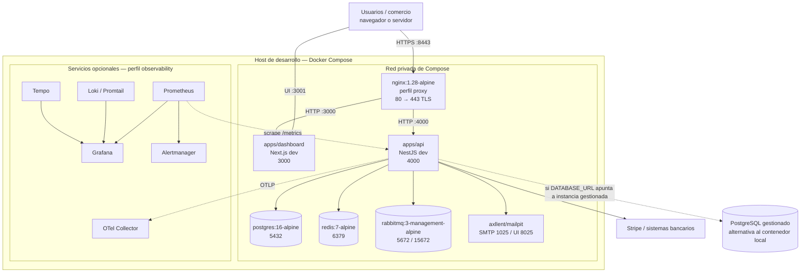

# Diagrama de despliegue

Diagrama de referencia para desarrollo con Docker Compose. Los contenedores se
ejecutan en un host Docker; PostgreSQL puede ser el contenedor local o una
instancia gestionada accesible desde la red del host.

En Compose, los puertos se publican solo donde lo indican los archivos
Compose: Dashboard `3001`, API por NGINX `8443` (y redirección HTTP `8080`),
Mailpit `8025`, RabbitMQ management `15672`, Grafana opcional `3002`,
Prometheus opcional `9090`, PostgreSQL local `127.0.0.1:5433`.

El TLS de NGINX cubre el salto desde el host al proxy. La red Docker usa HTTP,
AMQP y conexiones de base según configuración; el despliegue de producción debe
definir explícitamente cifrado de cada conexión y no hereda automáticamente
estas garantías del diagrama local.

Para el ensayo de escalado existe un override de carga con dos API replicas,
Redis compartido y NGINX resolviendo el servicio Docker `api`. Ese escenario es
de prueba y no significa que el Compose base despliegue dos réplicas.
