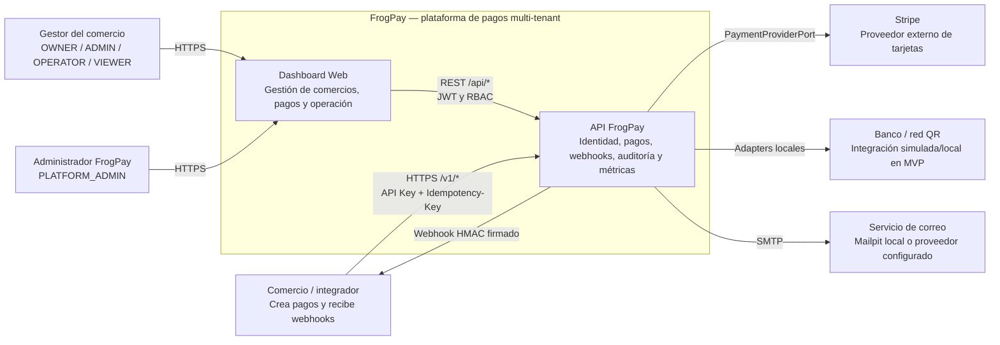

# C4 nivel 1 — Contexto del sistema

**Alcance:** el sistema ofrece API de pagos y una interfaz de gestión. Los
comercios integran sus servidores con la API y validan la firma HMAC de los
webhooks salientes. Los gestores y administradores usan el Dashboard con roles
separados. Stripe es el proveedor externo de tarjeta; QR y transferencia se
integran con adapters del MVP.
