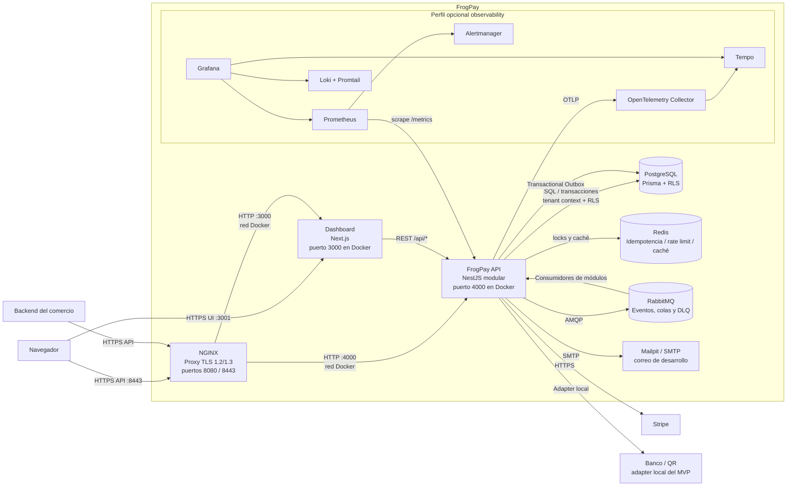

# C4 nivel 2 — Contenedores

**Límites de red:** Compose publica Dashboard en `localhost:3001`, Mailpit en
`localhost:8025`, RabbitMQ management en `localhost:15672` y Redis en
`localhost:6379`. PostgreSQL local se publica solo en `127.0.0.1:5433`.
La API no publica `4000` al host en el Compose normal; el navegador accede a la
API a través de NGINX en `https://localhost:8443` con el perfil `proxy`.

El perfil `observability` se define en `docker-compose.observability.yml` y
agrega Grafana (`localhost:3002`), Prometheus (`localhost:9090`), Loki,
Tempo, collector y Alertmanager. Su habilitación requiere ambas definiciones
Compose y una contraseña local para Grafana.
