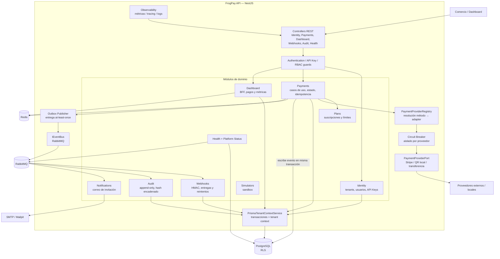

# C4 nivel 3 — Componentes de la API

**Lectura del diagrama:** las rutas HTTP autentican/autorizan antes de ejecutar
casos de uso. Pagos selecciona proveedores por interfaz y registry; no importa
directamente sus SDKs. Los cambios financieros escriben el evento en el outbox
dentro de la transacción de negocio y el publicador lo entrega a RabbitMQ. Los
consumidores de Webhooks, Auditoría y Notifications reaccionan de forma
asíncrona. Las consultas tenant-scoped pasan por el contexto transaccional que
establece la variable usada por las políticas RLS.

`Observability` es un módulo transversal del proceso API. No es un servicio de
negocio independiente ni se comunica directamente con todos los módulos a
través de una API remota.
