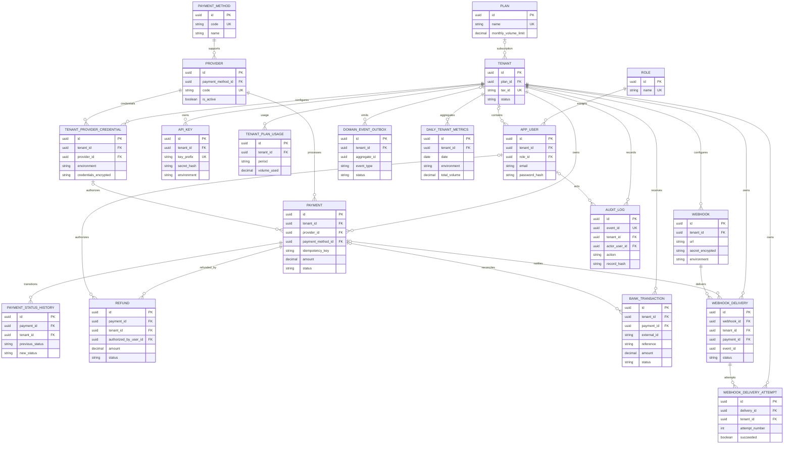

# ERD lógico final de FrogPay

El diagrama Mermaid siguiente representa las entidades y relaciones lógicas
vigentes en `apps/api/prisma/schema.prisma` (18 modelos). Los nombres de campo
se reducen a identificadores y atributos relevantes para lectura. Para tipos,
índices y nulabilidad exactos, usar el schema Prisma y las migraciones SQL.

## Reglas de integridad que no se ven completamente en el ERD

- RLS por `tenant_id` protege las tablas tenant-scoped; el rol de aplicación
  debe ser `NOBYPASSRLS`. El contexto tenant se establece en cada transacción.
- Las relaciones financieras usan claves foráneas compuestas con `tenant_id`
  para impedir asociaciones cruzadas. En particular, historial, reembolsos,
  entregas de webhook y depósitos referencian pagos dentro del mismo tenant.
- Una API Key se persiste como hash (`secret_hash`), y credenciales de proveedor
  y secretos de webhook se almacenan cifrados.
- La idempotencia de pago se garantiza con unicidad por tenant y clave.
- Auditoría es append-only; hash encadenado, triggers, permisos y restricciones
  están definidos en migraciones SQL.
- `domain_event_outbox` se escribe en la transacción de negocio y se publica
  con entrega at-least-once.
