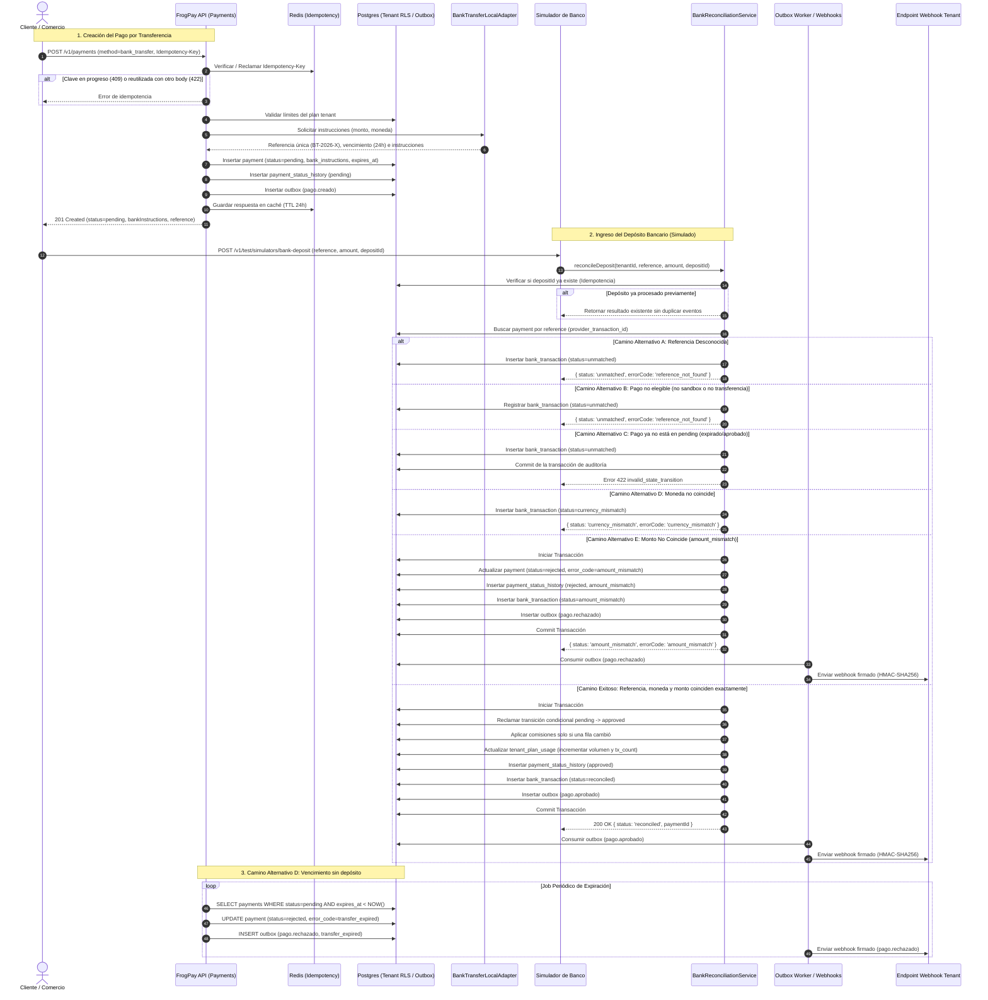

# Diagrama de Flujo: Transferencia Bancaria y Conciliación

> TSK-ARQ-306 — Sprint 3 (HU-19, HU-20, HU-21).

Este documento describe el flujo completo de pago mediante transferencia bancaria simulada, desde la creación del pago en el Dashboard/API hasta la recepción del depósito, conciliación automática y notificación vía Webhook.

---

## 1. Diagrama de Secuencia (Flujo Principal y Caminos Alternativos)

---

## 2. Resumen de Estados del Pago y Transición

| Estado Inicial | Evento / Disparador | Condición | Estado Final | Código de Error | Evento Outbox |
|---|---|---|---|---|---|
| Ninguno | `POST /v1/payments` | Datos válidos, clave idempotente | `pending` | `null` | `pago.creado` |
| `pending` | Depósito bancario | Monto y referencia coinciden | `approved` | `null` | `pago.aprobado` |
| `pending` | Depósito bancario | Referencia coincide, moneda difiere | `pending` | `currency_mismatch` | Ninguno (depósito `currency_mismatch`) |
| `pending` | Depósito bancario | Referencia coincide, monto difiere | `rejected` | `amount_mismatch` | `pago.rechazado` |
| `pending` | Depósito bancario | Referencia desconocida | `pending` (sin cambio) | N/A | Ninguno (depósito `unmatched`) |
| `pending` | Expiración de tiempo | `expires_at < NOW()` | `rejected` | `transfer_expired` | `pago.rechazado` |
| `approved` / `rejected` | Depósito tardío | Pago ya cerrado | Sin cambio | `invalid_state_transition` | Ninguno (depósito `unmatched` auditado) |
